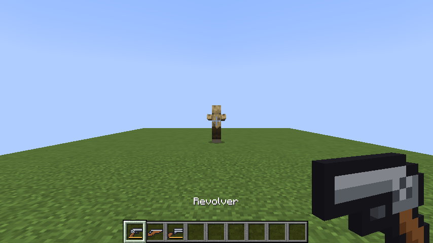
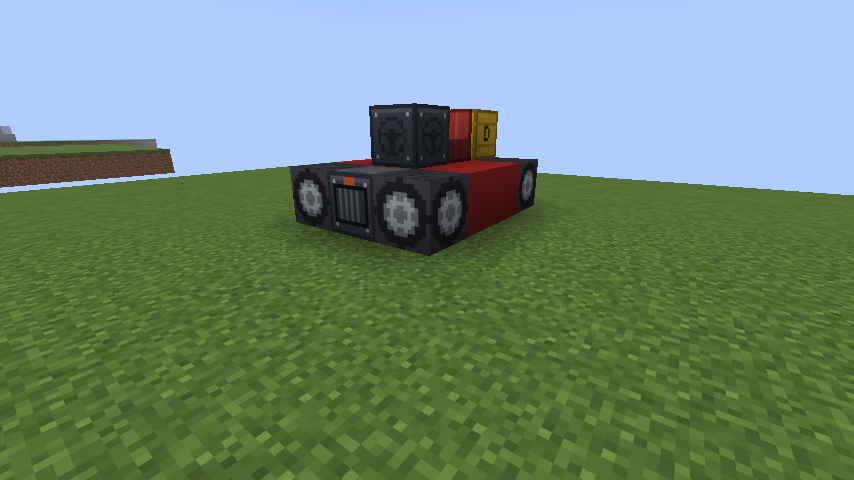
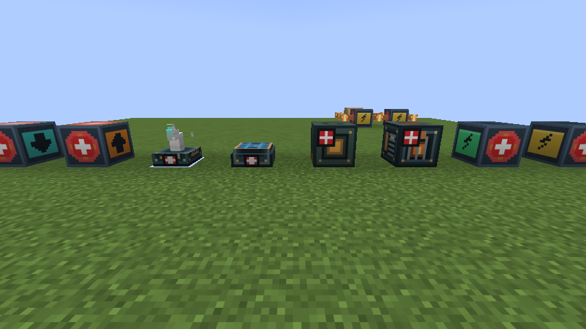

# Modernization World 1.0.0

Fabric · Minecraft 26.3 · Java 25 · Fabric API 필요

**Analog ALU**(아날로그 레드스톤 컴퓨터, 전기 회로, 석유, 반도체)와 **Redstone Transportation**(자동 철도, 전차, 공장 기계, 직접 짓는 엘리베이터·배·비행선)을 하나로 합친 모드입니다. Analog ALU는 0.2.2(석유화학, 감전과 피복 전선, 옷, 전기충격기, 아스팔트)까지 들어 있습니다. 1.0.0에서 3D 총기와 흑색화약, 블록으로 짓는 디젤 자동차, 음반 두 장이 추가됐고, 운동화가 강해졌고, 자동화 기계가 220V 200Ω 부하가 됐으며, 전원 직렬·병렬 연결, 더 잘 보이는 +/− 표시, 더 희귀해진 석유가 들어갔습니다.



## 설치

1. `mods` 폴더에 `modernization-world-1.0.0.jar`와 Fabric API를 넣습니다.
2. 예전의 `analog-alu-*.jar`, `redstone-transportation-*.jar`는 **빼세요.** 두 모드가 이 jar 하나에 들어 있습니다.

기존 월드는 그대로 이어서 할 수 있습니다. 블록과 아이템 ID(`analog_alu:…`, `redstone_transportation:…`)를 바꾸지 않았고, 이 모드가 두 모드 ID를 대신 제공합니다.

## 1.0.0에서 바뀐 것

| 기능 | 내용 | 설명서 |
|---|---|---|
| 총기 | 리볼버(6발, 매번 R, 25 피해, 32블록), 머스킷(30 피해, 48블록, 3초 간격), 샷건(2발, 산탄 40알, 16블록). 손에 들면 3D 모델 | [docs/GUNS_KO.md](docs/GUNS_KO.md) |
| 흑색화약 | 화약 + 석탄(또는 숯). 9mm 총알, 머스킷 총알, 45게이지 산탄의 재료. 화약은 뼛가루 + 석탄/숯 + 부싯돌로도 만듦 | [docs/GUNS_KO.md](docs/GUNS_KO.md) |
| 석유 | 매장지가 예전의 5%(구역당 3.75%)로 줄고, 그중 90%가 지표에 드러남 | [README.TXT](README.TXT) 7장 |
| 전원 직렬·병렬 | 건전지·발전기를 여러 개 이으면 직렬은 전압이 더해지고 병렬은 전류를 나눔 | [전기 가이드](docs/transportation/ELECTRIC_GUIDE_KO.md) |
| +/− 표시 | 모든 전원의 + 면과 − 면에 크게 표시 | [전기 가이드](docs/transportation/ELECTRIC_GUIDE_KO.md) |
| 자동화 기계 220V | 벌목기를 뺀 기계는 220V 200Ω. 공장 제어기가 기계 n대를 200/n Ω 부하로 대표하고, 전압에 비례해 속도가 정해짐. 승압기 화면에 220 입력, 선은 PVC 피복 전선으로 | [전기 가이드](docs/transportation/ELECTRIC_GUIDE_KO.md) |
| 자동차 | 운전대·좌석·바퀴 4개·디젤 엔진·연료통을 붙여 조립. 디젤로 최고 약 43km/h, 한 칸 턱을 넘음 | [자동차 가이드](docs/transportation/CAR_GUIDE_KO.md) |
| 배·비행선 연료 | 배와 비행선도 연료통이 있어야 조립되고 디젤로 움직임. 다 떨어지면 배는 멈추고 비행선은 떠 있음 | [구조물 가이드](docs/transportation/STRUCTURE_GUIDE_KO.md) "연료" |
| 운동화 | 내구도 무한, 인챈트 가능, 속도 +20%, 걷기·달리기·점프에 허기 없음, 1.8칸을 계단처럼 오름. 제작법 그대로 | [CHANGELOG](CHANGELOG_1.0.0_KO.md) 7장 |
| 음반 | Sia - Snowman, Maroon 5 - Payphone. 주크박스에서 재생, 크리퍼 드롭, 아무 음반 + 눈 블록/종으로 제작 | [CHANGELOG](CHANGELOG_1.0.0_KO.md) 9장 |
| ALU 0.2.2 | 석유화학(나프타 → 플라스틱·섬유·고무), 감전과 PVC·PP 피복 전선, 승압기 전압 직접 입력, 전기충격기, 옷, 아스팔트 | [CHANGELOG](CHANGELOG_1.0.0_KO.md) 8장 |
| 두 모드 합치기 | Analog ALU + Redstone Transportation → Modernization World | 아래 |

자세한 내용과 검증 결과는 [CHANGELOG_1.0.0_KO.md](CHANGELOG_1.0.0_KO.md)에 있습니다.





## 문서

- [README.TXT](README.TXT): Analog ALU 쪽 블록 설명 (영문) — 논리 블록, 전기 회로, 석유, 반도체, 웨이퍼 프로그램, 총기
- [docs/GUNS_KO.md](docs/GUNS_KO.md): 총기와 흑색화약
- [docs/transportation/README_KO.md](docs/transportation/README_KO.md): 운송·공장·구조물 전체 설명
  - [AUTOMATION_GUIDE_KO.md](docs/transportation/AUTOMATION_GUIDE_KO.md): 자동화 기계, 평지화 기계, 강화 화로
  - [RAIL_GUIDE_KO.md](docs/transportation/RAIL_GUIDE_KO.md): 동력 선로, 선로 부설기, 정거장
  - [STRUCTURE_GUIDE_KO.md](docs/transportation/STRUCTURE_GUIDE_KO.md): 엘리베이터, 배, 비행선
  - [CAR_GUIDE_KO.md](docs/transportation/CAR_GUIDE_KO.md): 자동차
  - [ELECTRIC_GUIDE_KO.md](docs/transportation/ELECTRIC_GUIDE_KO.md): 전기로 움직이는 블록, 220V 공장, 직렬·병렬, +/− 표시

운송 쪽 문서는 합치기 전에 쓴 것이라 "Analog ALU를 함께 설치하세요" 같은 문장이 남아 있습니다. 이제 ALU가 늘 들어 있으므로 동력 선로·모터·기계·컨베이어는 항상 전기로 움직입니다.

## 빌드와 테스트

JDK 25와 Gradle 9.8.1이 필요합니다.

```bash
gradle build
```

`build/libs/modernization-world-1.0.0.jar`가 만들어집니다.

```bash
gradle runGameTest
```

서버 게임 테스트 214개(운송 172, 전원 7, 총기 12, 석유 3, 자동차 6, 배·비행선 연료 4, 정박 2, 운동화·음반·피복 전선 8)를 돌립니다.

```bash
gradle runClientGameTest
```

실제 클라이언트를 띄워 클릭과 키 입력으로 확인하고, `docs/previews`의 사진을 찍습니다. `RT_SHOTS=guns,car`처럼 환경 변수를 주면 그 장면만 찍습니다(`guns`, `car`, `power`, `electric`, `music`).

리소스 생성 스크립트는 `tools/`에 있습니다(표준 라이브러리만 사용).

| 스크립트 | 만드는 것 |
|---|---|
| `gen_gun_assets.py` | 총기 3D 모델과 평면 아이콘, 탄약·흑색화약 텍스처, 레시피, 이름, 총알 피해 종류 |
| `gen_terminal_marks.py` | 전원의 +/− 표시 |
| `generate_assets.py` | 운송 쪽 블록·아이템 리소스(자동차 부품 포함) |
| `gen_music_discs.py` | 음반 텍스처, 모델, sounds.json, 주크박스 곡, 제작법, 이름 (음원 .ogg는 따로 변환, 스크립트 머리말 참고) |
| `gen_*.py` (그 밖) | ALU 쪽 리소스 |

## 소스 구조

- `src/main/java/com/example/analogalu/` — ALU: 논리 블록, 전기 회로(`block/CircuitSolver.java`), 석유(`worldgen/OilDeposits.java`), 반도체, 총기(`gun/`)
- `src/main/java/com/example/modernizationworld/` — 합친 모드 자체의 것: 음반
- `src/main/java/com/example/redstonetransportation/` — 운송: 철도, 전차, 공장 기계(`machine/ControllerPower.java`: 220V 부하), 평지화 기계, 움직이는 구조물과 자동차(`structure/MovingStructureEntity.java`)
- `src/gametest/` — 게임 테스트
