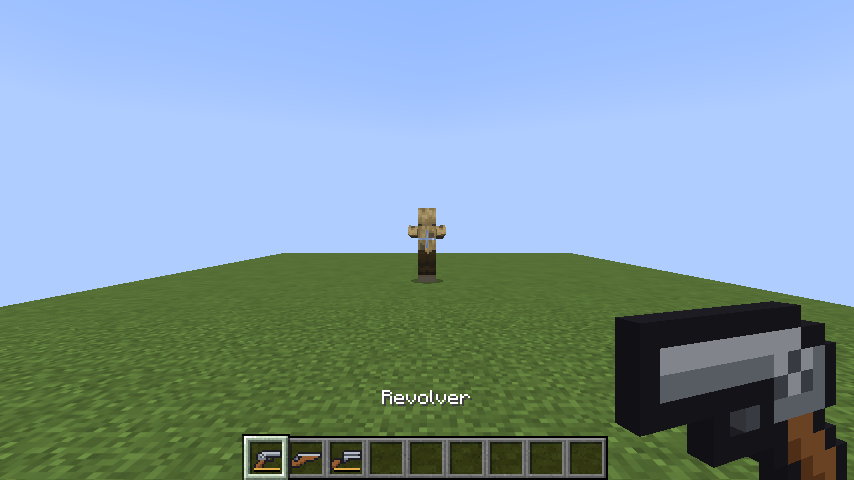
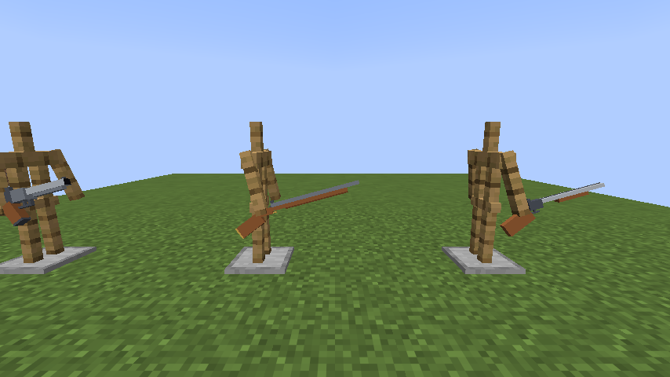
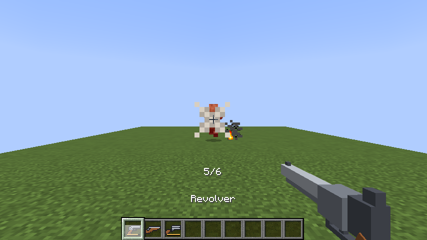
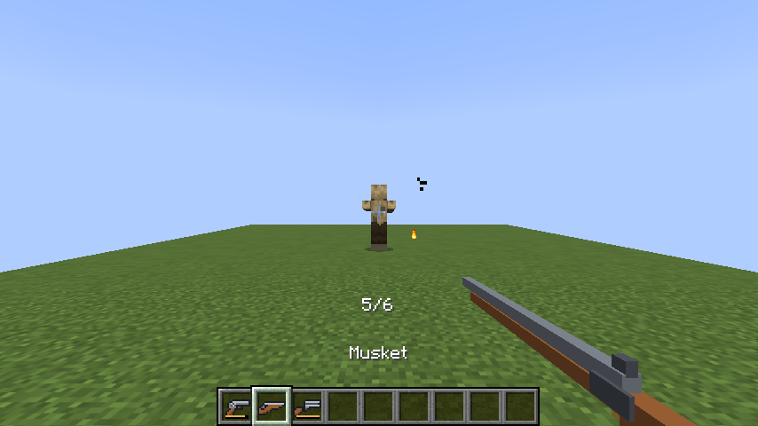
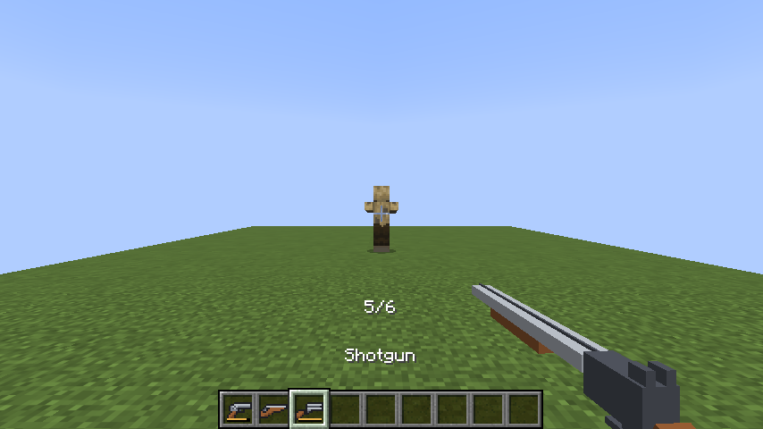

# 총기 가이드 (Modernization World 1.0.0)

리볼버, 머스킷, 샷건 세 가지 총과 흑색화약, 탄약을 추가했습니다.



## 공통

- **쏘기**: 우클릭.
- **R 키**: 리볼버의 공이치기를 당기거나 재장전합니다. 조작 설정의 "총기 → 총: 공이치기 / 재장전"에서 바꿀 수 있습니다.
- 총알은 날아가는 시간 없이 바로 맞습니다. 처음 닿는 단단한 블록에서 멈추고, 사거리 안에서 가장 먼저 닿는 생물을 맞힙니다.
- 피해는 체력 기준입니다(플레이어 체력은 20). **갑옷과 발사체 보호 인챈트가 피해를 줄입니다.**
- 빠르게 연달아 쏴도 피해가 그대로 들어갑니다(맞은 직후 잠깐의 무적 시간을 무시).
- 핫바의 총 아래 막대가 남은 장탄 수를 보여 줍니다. 쏠 때마다 화면 가운데 아래에 "5/6"처럼 나옵니다.
- 크리에이티브 모드에서는 탄약이 필요 없습니다.
- 손에 든 총은 입체(3D) 모델입니다. 1인칭에서는 총구가 앞을 향하고, 다른 사람에게는 손에 쥔 모습으로 보입니다. 인벤토리와 액자에서는 알아보기 쉽게 평면 그림으로 나옵니다.



## 리볼버

| 항목 | 값 |
|---|---|
| 장탄 | 6발 |
| 피해 | 25 |
| 사거리 | 32블록 |
| 탄약 | 9mm 총알 |
| 재장전 | 6발을 다 쓴 뒤 R, 4초 |

1. **R**을 눌러 공이치기를 당깁니다.
2. 우클릭으로 쏩니다.
3. 다음 발도 **매번 R → 우클릭**입니다. 공이치기를 당기지 않고 우클릭하면 "철컥" 소리만 납니다.
4. 6발을 다 쓰면 **R**로 재장전합니다. 4초 뒤 인벤토리의 9mm 총알로 6발이 채워집니다.



## 머스킷

| 항목 | 값 |
|---|---|
| 피해 | 30 |
| 사거리 | 48블록 |
| 탄약 | 머스킷 총알 (쏠 때마다 1개) |
| 다음 발까지 | 3초 |

R 없이 우클릭만으로 쏩니다. 쏠 때마다 인벤토리의 머스킷 총알을 하나씩 바로 넣어 쏘므로 따로 재장전하지 않지만, 한 번 쏘면 3초를 기다려야 합니다.



## 샷건

| 항목 | 값 |
|---|---|
| 장탄 | 2발 |
| 산탄 | 한 발에 40알, 원뿔 모양(반각 9도)으로 퍼짐 |
| 피해 | 한 알에 1.5 (가까이서 다 맞으면 60) |
| 사거리 | 16블록 |
| 탄약 | 45게이지 산탄 |
| 재장전 | R, 3.5초 (2발 장전) |

R로 재장전하면 두 번 쏠 수 있습니다. 가까울수록 많은 알이 맞고, 한 대상에 맞은 알의 피해는 한 번에 더해서 들어갑니다. 16블록보다 멀면 맞지 않습니다.



## 제작법

**흑색화약**: 화약 + 석탄(또는 숯) → 흑색화약 1개 (모양 없이)

**화약**: 뼛가루 + 석탄(또는 숯) + 부싯돌 → 화약 4개 (모양 없이). 바닐라에는 화약 조합법이 없어서 넣었습니다. 크리퍼를 잡지 않아도 총알을 만들 수 있습니다.

| 탄약 | 재료 (모양 없이) | 나오는 수 |
|---|---|---|
| 9mm 총알 | 흑색화약 + 철 주괴 | 4 |
| 머스킷 총알 | 흑색화약 + 철 주괴 2 | 4 |
| 45게이지 산탄 | 흑색화약 + 철 조각 8 | 1 |

총 (3×3, 위에서 아래로):

```text
리볼버            머스킷             샷건
철   철   철      철   .    .       철   철   .
.    트립 판자    .    철   부싯     철   트립 부싯
.    .    판자    .    .    원목     .    원목 원목
```

- 철 = 철 주괴, 트립 = 트립와이어 갈고리, 판자 = 아무 판자, 원목 = 아무 원목, 부싯 = 부싯돌과 부시

## 알아둘 점

- 피해량 25·30은 체력 기준이라, 갑옷이 없는 플레이어는 리볼버 한 발에 쓰러집니다. 다이아몬드 갑옷 한 벌이면 리볼버 피해가 약 9로 줄어듭니다.
- 플레이어끼리 맞히는 것은 서버의 PvP 설정을 따릅니다.
- 엔더맨은 화살처럼 총알도 피합니다(발사체로 분류).
- 샷건의 한 알 피해 1.5는 이번에 정한 값입니다. 바꾸고 싶으면 알려 주세요.
