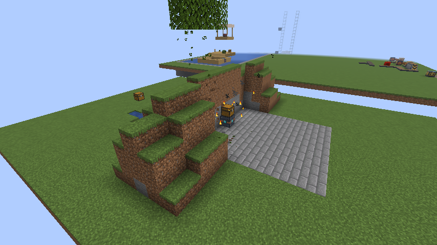
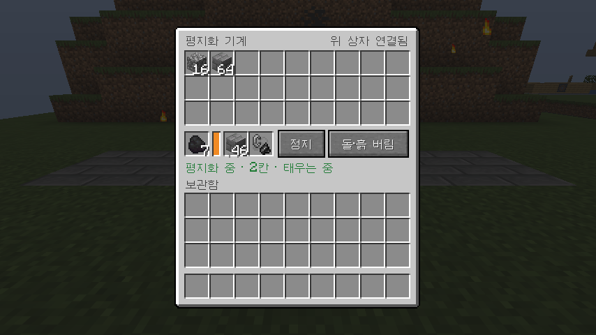
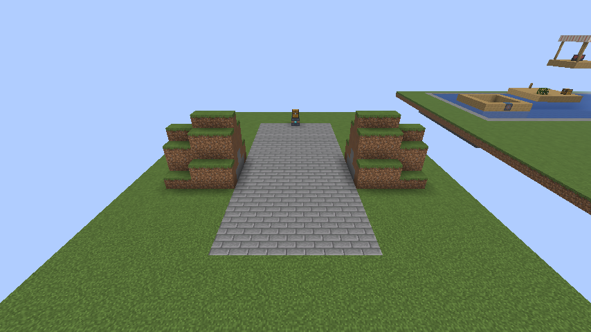

# 자동화 공장 가이드 (1.15.0)

공장은 기계 블록을 나란히 붙여서 만듭니다. 모든 기계는 같은 규칙으로 움직이므로, 나무 공장을 만드는 방법을 알면 다른 공장도 같은 방법으로 만들 수 있습니다.

> 기계와 컨베이어는 레드스톤 대신 전기로 움직입니다. 아래의 신호는 전기로 읽으면 됩니다. [`ELECTRIC_GUIDE_KO.md`](ELECTRIC_GUIDE_KO.md)
>
> **Modernization World 1.0.0부터** 벌목기를 뺀 기계는 220V 200Ω 부하이고, **공장 제어기를 통해서만** 전기를 받습니다. 제어기의 마주 보는 두 면에 220V를 걸면 연결된 기계가 최고 속도로 돕니다. 제어기 없이 케이블에 바로 붙인 기계는 움직이지 않습니다(벌목기는 예외). 자세한 것은 전기 가이드의 "자동화 기계는 220V 200Ω"을 보세요.

## 1. 공통 규칙

1. **작업 범위**: 기계 윗면 화살표 쪽 앞의 **9×9** 칸을 작업합니다. 기계를 설치하면 화살표가 바라보는 방향(설치자 반대쪽)을 향합니다. 높이는 기계 기준 아래 1칸 ~ 위 1칸입니다. 채굴 드릴만 기반암까지 내려갑니다. **벌목기는 범위가 없고 기계에 닿아 있는 나무만 벱니다.**
   - **공장 제어기에 연결된 기계는 같은 9×9를 공유합니다.** 줄의 가운데를 기준으로, 맨 앞 기계 바로 앞에 구역이 잡힙니다. 제어기 없이 기계를 나란히 놓으면 범위가 한 칸씩 어긋나서 식재기가 벌목기 손이 안 닿는 곳에 심을 수 있으니, 공장에는 제어기를 쓰세요.
2. **신호**: 신호 1~15가 들어와야 작동합니다. 신호가 강할수록 빠르고, 15는 1보다 15배 빠릅니다. 레드스톤, Analog ALU 출력, Copper Wire를 모두 받습니다.
3. **아이템 흐름**: 맞닿은 블록끼리 아이템을 주고받습니다.
   - 수확하는 기계(벌목기, 수확기, 드릴, 수거기)는 **옆 기계에 먼저**, 그다음 상자에 넣습니다. 상자가 없으면 옆 컨베이어에 내려놓습니다.
   - 소비하는 기계(식재기, 촉진기)는 필요한 아이템만 받고, 옆 상자에서 직접 가져옵니다.
   - 바닐라 호퍼도 일반 컨테이너처럼 연결됩니다.
4. **상태 표시**: 윗면 화살표 색으로 상태를 봅니다.

| 색 | 상태 |
|---|---|
| 회색 | 꺼짐 (신호 없음) |
| 노란색 | 대기 (할 일 없음) |
| 초록색 | 작업 중 |
| 빨간색 | 막힘 (재료 없음 또는 내부 9칸이 가득 참) |

우클릭하면 내부 9칸이 열리고, Shift+우클릭하면 방향이 돌아갑니다. 비교기를 대면 내부가 찬 정도를 0~15로 읽을 수 있습니다.

## 2. 기계 목록

| 블록 | ID | 역할 |
|---|---|---|
| 벌목기 | `tree_cutter` | 줄기가 기계에 닿아 있는 나무를 통째로 벱니다. 잎을 먼저 베어 묘목을 회수하고, 줄기는 위에서부터 벱니다. 천연 잎이 없는 원목(집 벽 등)은 닿아 있어도 건드리지 않습니다. |
| 자동 식재기 | `auto_planter` | 묘목, 씨앗, 네더 사마귀를 심습니다. 근처에 벌목기가 있으면 묘목은 벌목기와 맞닿은 칸에만 심고, 없으면 3칸 간격으로 심습니다. |
| 성장 촉진기 | `growth_booster` | 뼛가루를 써서 묘목과 작물을 키웁니다. 잔디밭에 뼛가루를 낭비하지 않습니다. |
| 작물 수확기 | `crop_harvester` | 다 자란 작물만 거두고 바로 다시 심습니다. 밀, 당근, 감자, 비트, 네더 사마귀, 코코아, 달콤한 열매, 호박, 수박, 사탕수수, 선인장, 대나무를 지원합니다. |
| 채굴 드릴 | `quarry_drill` | 앞쪽 9×9를 한 층씩 기반암까지 팝니다. 레일, 상자, 기계는 남겨 둡니다. 저장 후 이어서 팝니다. |
| 아이템 수거기 | `item_collector` | 작업 범위에 떨어진 아이템을 모읍니다. |
| 공장 제어기 | `factory_controller` | 맞닿아 이어진 기계 전체를 한 번에 제어합니다. |
| 컨베이어 벨트 | `conveyor_belt` | 아이템과 생물을 나르고, 끝에 있는 상자에 직접 넣습니다. 신호를 받으면 멈춥니다. 레일처럼 저절로 이어집니다. |

**공장 제어기**는 우클릭할 때마다 모드가 바뀝니다.

- 정지: 연결된 기계가 전부 멈춥니다. 기계에 따로 신호가 들어와 있어도 멈춥니다.
- 가동: 전부 최고 속도로 돌아갑니다.
- 신호 제어: 제어기에 들어오는 0~15 신호가 전체 속도가 됩니다. 1.0.0부터는 전기로 낼 수 있는 속도보다 빨라지지 않습니다.
- Shift+우클릭: 제어기에 걸린 전압, 전류, 전력과 연결된 기계 수를 봅니다.

제어기는 기계끼리 맞닿은 덩어리 전체(최대 128대)에 적용되고, 같은 방향을 보는 기계들의 작업 구역을 하나로 맞춥니다.

## 3. 나무 공장 만들기

위에서 본 배치입니다. 윗줄 쪽이 작업 방향입니다.

```text
              [ 나무 자리 ]            ← 벌목기 바로 앞 한 칸, 아래는 흙이나 잔디
   [ 식재기 ][ 벌목기 ][ 촉진기 ]     ← 세 기계 모두 화살표가 나무 자리 쪽
   [ 제어기 ][  상자  ][ 수거기 ]
```

1. 기계를 위처럼 맞닿게 놓습니다. 나무 자리 위는 나무가 자라도록 비워 둡니다.
2. 제어기를 우클릭해 **가동**으로 맞춥니다.
3. 식재기를 열고 묘목을 넣습니다.
4. 촉진기를 열고 뼛가루를 넣습니다. 없어도 묘목은 자연히 자라지만 느립니다.

그 뒤로는 저절로 돌아갑니다.

- 식재기가 벌목기 앞 칸에 심고, 촉진기가 키웁니다.
- 나무가 다 자라면 줄기가 벌목기에 닿아 있으므로 벌목기가 통째로 벱니다.
- 잎에서 나온 묘목은 옆 식재기로 돌아가 다시 심깁니다.
- 통나무와 사과, 막대기는 상자로 들어갑니다.
- 상자가 가득 차면 벌목기가 빨간색으로 멈춥니다. 아이템이 사라지지 않습니다.

벌목기는 **닿아 있는 나무만** 벱니다. 줄기가 기계의 어느 면이든 닿으면 되고, 중간 높이에 닿아도 나무 전체를 벱니다. 한 칸이라도 떨어져 있으면 작동하지 않습니다. 이 배치는 한 번에 나무 한 그루를 키웁니다. 묘목 4개가 모여야 자라는 짙은 참나무는 이 배치로 키울 수 없습니다.

손으로 쓸 때는 벌목기를 나무 줄기에 붙여 놓고 신호를 주면 됩니다.

## 4. 다른 공장도 같은 방법으로

같은 방식으로 기계를 붙여서 만듭니다.

| 공장 | 구성 | 넣어 줄 것 |
|---|---|---|
| 농작물 공장 | 식재기, 수확기, 촉진기를 나란히 놓고 그 앞에 경작지 9×9(가운데 물 1칸), 수확기 뒤에 상자, 옆에 제어기 | 씨앗, 뼛가루 |
| 채굴 공장 | 채굴 드릴 + 뒤에 상자 + 옆에 제어기 | 없음 |
| 화물역 | 상자 + 그 아래 호퍼 + 호퍼 아래 동력 선로 | 상자에 보낼 물건 |

필요한 기계만 골라 붙여도 됩니다. 예를 들어 **사탕수수 공장**은 수확기 + 상자 + 물가의 사탕수수, **창고 직송 채굴장**은 채굴 드릴 → 컨베이어 → 상자로 만듭니다. 공장 물건을 멀리 보내려면 [레일 가이드](RAIL_GUIDE_KO.md)의 화물 싣고 내리기를 참고하세요.

### 새 기계를 추가하기 (개발자용)

기계 하나는 Java 클래스 하나와 표 항목 하나로 만듭니다. 내부 칸, 신호, GUI, 저장, 아이템 이동은 공용 코드가 처리합니다.

1. `machine/work/`에 `MachineWork`를 구현합니다. `run()`은 작업 한 번을 하고 `WORKED`, `IDLE`, `BLOCKED` 중 하나를 돌려줍니다.
2. `MachineType`에 항목을 추가합니다. (ID, 역할, 작업 간격, 받는 아이템)
3. `tools/generate_assets.py`의 `MACHINES`, `FRONT_ICONS`, `RECIPES`에 추가하고 실행합니다.
4. 언어 파일에 이름과 툴팁을 넣습니다.

## 5. Analog ALU로 공장 제어하기

- ALU 출력이나 Copper Wire를 벌목기에 바로 연결하면 그 값이 4비트 작업 속도가 됩니다. 다른 기계는 제어기를 거쳐야 합니다.
- 공장 전체를 조절하려면 제어기를 **신호 제어** 모드로 두고 ALU 출력을 제어기에 연결합니다.
- ALU 0.1.2의 Logical AND/OR/XOR는 0과 0이 아닌 값을 판정해 0 또는 15를 냅니다. "이 조건일 때만 공장 가동" 회로에 바로 쓸 수 있습니다.
- 비교기로 상자나 기계의 잔량을 읽어 ALU에 넣으면 "상자가 찼을 때만 멈추기", "재고가 적을 때 빠르게 돌리기" 같은 회로를 만들 수 있습니다.

## 6. 컨베이어 잇기

벨트는 바라보는 방향으로 놓이고, 레일처럼 옆 벨트에 맞춰 모양이 저절로 바뀝니다.

- **꺾기**: 줄의 끝 칸 옆에, 그 끝 칸에서 멀어지는 방향을 보고 벨트를 놓으면 끝 칸이 곡선으로 바뀌어 이어집니다.
- **옆에서 받기**: 뒤에서 들어오는 벨트 없이 옆에서만 들어오면 곡선이 됩니다. 좌우 양쪽에서 들어오면 T자로 합쳐져 한 줄로 나갑니다. 뒤에서도 들어오면 직선을 유지하고 옆줄이 합류합니다.
- **오르막**: 앞쪽 한 칸 위에 벨트를 놓으면 아래 벨트가 경사가 됩니다. 위에 놓을 벨트를 받칠 블록은 직접 놓아야 합니다.
- **내리막**: 뒤쪽 한 칸 위에서 내려오는 벨트가 있으면 아래 벨트가 경사가 됩니다.

바꾸지 않는 경우도 있습니다.

- 나란히 놓는 평행한 벨트는 합쳐지지 않습니다. 새 벨트의 뒤쪽이 끝 칸에 닿을 때만 그 끝 칸이 꺾입니다.
- 상자나 다른 벨트로 이어져 있는 끝 칸은 꺾이지 않습니다.
- 위아래로 겹쳐 놓은 벨트는 경사가 되지 않습니다.
- 경사 칸은 곡선이 될 수 없습니다. 꺾으려면 경사 앞뒤에 평평한 칸을 두세요.

경사가 멈추면 아이템은 그 자리에 머뭅니다.

## 7. 제작법

게임에 접속하면 제작법이 전부 해금되어 제작대의 레시피북에 나옵니다. 아래 표는 같은 내용입니다.

`I`=철괴, `R`=레드스톤, `M`=레드스톤 전차 모터 I, `S`=Analog ALU의 반도체

자동화 기계는 반도체가 들어가고 한 번에 4개가 나옵니다.

| 블록 | 1행 | 2행 | 3행 | 만드는 수 |
|---|---|---|---|---|
| 벌목기 | I 철도끼 I | S M S | I 상자 I | 4개 |
| 자동 식재기 | I 밀 씨앗 I | S M S | I 발사기 I | 4개 |
| 성장 촉진기 | I 뼛가루 블록 I | S M S | I 발사기 I | 4개 |
| 작물 수확기 | I 철 괭이 I | S M S | I 상자 I | 4개 |
| 채굴 드릴 | I 다이아몬드 곡괭이 I | S M S | I 상자 I | 4개 |
| 아이템 수거기 | I 호퍼 I | S M S | I 상자 I | 4개 |
| 공장 제어기 | I S I | 비교기 M 비교기 | I S I | 4개 |
| 컨베이어 벨트 | 가죽 가죽 가죽 | I R I | | 6개 |

**Analog ALU 없이 플레이할 때**: 반도체를 구할 수 없으므로, 위 표에서 `S` 자리에 레드스톤을 넣습니다. 이때는 1개씩 나옵니다. ALU를 설치하면 이 조합법은 사라집니다.

## 평지화 기계

앞으로 한 칸씩 나아가며 땅을 평평하게 만드는 기계입니다. 지나간 자리에는 너비 9칸짜리 평지가 남습니다.



### 하는 일

- 기계 앞쪽 9칸 너비에서, 기계가 서 있는 높이부터 위로 32칸까지 있는 블록을 모두 캐냅니다. 언덕, 나무, 물, 용암이 모두 사라집니다.
- 바닥(기계 바로 아래 높이)에 구덩이가 있으면 흙이나 돌로 메웁니다. 그래서 지나간 길은 한 높이로 평평합니다.
- 메울 블록 칸에 블록을 넣으면 지나가는 바닥 전체를 그 블록으로 깝니다. 석재 벽돌을 넣으면 석재 벽돌 길이 됩니다.
- 캐낸 것은 기계 안 보관함(27칸)에 들어갑니다. 라이터를 넣으면 보관하지 않고 태웁니다. 다이아몬드 곡괭이로 캔 것처럼 나오므로 돌은 조약돌, 잔디는 흙, 광석은 원석이 됩니다.
- 1초에 1칸씩 움직입니다.

### 쓰는 법

1. 가고 싶은 방향을 바라보고 놓습니다. 윗면 화살표가 나아가는 방향입니다. 웅크리고 우클릭하면 방향이 90도씩 돕니다.
2. 우클릭해서 열고, 보관함 아래 맨 왼쪽의 연료 칸에 연료를 넣습니다.
3. (선택) 그 오른쪽의 **메울 블록** 칸에 바닥으로 깔 블록을 넣습니다.
4. (선택) 그 오른쪽의 **라이터** 칸에 부싯돌과 부시를 넣으면 캔 것을 태웁니다.
5. **가동** 버튼을 누릅니다. 다시 누르면 멈춥니다.

빈 연료·메울 블록·라이터 칸에 마우스를 올리면 무엇을 넣는 칸인지 나옵니다. 인벤토리에서 Shift+클릭하면 부싯돌과 부시는 라이터 칸, 연료는 연료 칸, 블록은 메울 블록 칸, 나머지는 보관함으로 갑니다.

메뉴를 열어 둔 채로 따라 걸으면 메뉴가 닫히지 않고 진행 상황을 계속 보여 줍니다.



### 연료

전기 케이블에 계속 붙어 있을 수 없으므로 연료로 움직입니다. 1칸에 연료 20틱을 씁니다.

| 연료 | 갈 수 있는 거리 |
|---|---|
| 석탄, 숯 | 80칸 |
| 석탄 블록 | 800칸 |
| 용암 양동이 | 1000칸 (빈 양동이는 연료 칸에 남음) |
| ALU 디젤 | 320칸 |
| 원목, 판자 | 15칸 |

화로에 들어가는 연료는 모두 쓸 수 있습니다.

**연료 다시 채우기**: 연료 칸이 비면 **방금까지 쓰던 것과 같은 연료**를 보관함에서, 없으면 위에 올린 상자에서 꺼내 채웁니다. 석탄을 쓰고 있었다면 석탄만 가져오고, 캔 원목이나 막대기처럼 다른 연료는 쓰지 않습니다. 그래서 여분의 연료를 보관함이나 위 상자에 넣어 두면 멀리까지 갑니다. (캐다가 나온 석탄도 연료가 석탄이면 쓰입니다.)

### 돌·흙 버림 / 모두 보관

| 설정 | 동작 |
|---|---|
| 돌·흙 버림 (기본) | 조약돌, 흙, 모래, 자갈 같은 흔한 것은 256개(4묶음)까지만 보관하고 나머지는 버립니다. 광석, 원목 같은 나머지는 모두 보관합니다. |
| 모두 보관 | 하나도 버리지 않습니다. 보관함이 차면 멈춥니다. |

흔한 돌·흙으로 치는 것: 조약돌, 돌, 심층암, 흙, 거친 흙, 뿌리 내린 흙, 진흙, 안산암, 섬록암, 화강암, 응회암, 방해석, 사암, 붉은 사암, 모래, 붉은 모래, 자갈, 네더랙, 영혼 흙, 흑암, 현무암, 매끄러운 현무암, 엔드 돌, 테라코타(색깔 포함). 데이터팩으로 `redstone_transportation:leveler_rubble` 아이템 태그에 더 넣을 수 있습니다.

### 메울 블록 (바닥 깔기)

메울 블록 칸에 블록을 넣으면 **지나가는 바닥 9칸을 모두 그 블록으로 바꿉니다.** 구덩이는 메우고, 원래 있던 바닥(잔디, 흙, 돌 등)은 캐서 보관함으로 가져옵니다. 이렇게 가져온 흙·돌도 다른 캔 것과 똑같이 "돌·흙 버림"과 라이터 설정을 따릅니다.



- **보관함에서 다시 채움**: 메울 블록 칸이 다 떨어지면 보관함에 있는 같은 블록 한 묶음을 칸으로 옮겨서 계속 깝니다. 먼 길을 깔 때는 보관함에 같은 블록을 넉넉히 넣어 두세요.
- **다 떨어지면 멈춤**: 칸과 보관함에 그 블록이 하나도 없으면 "메울 블록이 떨어짐"으로 멈춥니다. 다른 바닥으로 길이 이어지지 않게 하려는 것입니다. 블록을 더 넣으면 이어서 깝니다.
- **깔기 그만두기**: 메울 블록 칸에서 블록을 직접 꺼내면 깔기를 그만둡니다. 블록이 다 떨어져 멈췄을 때 깔지 않고 계속 가려면 **정지** 후 다시 **가동**을 누르세요.
- 이미 그 블록인 바닥은 그대로 두고, 기반암이나 상자처럼 캘 수 없는 바닥도 그대로 둡니다.
- 메울 블록 칸이 비어 있으면 지금까지처럼 구덩이만 흙·돌로 메웁니다. 이번에 캔 흙·돌을 먼저 쓰고, 모자라면 보관함의 흙·돌을 씁니다.

넣을 수 있는 것: 꽉 찬 한 칸짜리 블록이면 무엇이든 됩니다(석재 벽돌, 잔디, 판자, 유리, 콘크리트 등). 반 블록, 계단, 울타리처럼 꽉 차지 않은 블록, 모래·자갈·콘크리트 가루처럼 떨어지는 블록, 상자처럼 안에 무언가 담는 블록은 넣을 수 없습니다.

### 위에 올린 상자

기계 **바로 위**에 상자를 올려 두면 기계와 함께 움직입니다. 상자 안의 아이템과 이름도 그대로 따라옵니다. 맨 위 사진에서 기계 위에 실린 상자가 이것입니다.

- **더 큰 보관함**: 기계 보관함(27칸)이 차면 캔 것을 위 상자에 넣습니다. 둘 다 차야 "보관함이 가득 찼습니다"로 멈춥니다.
- **연료와 메울 블록 창고**: 연료 칸이나 메울 블록 칸이 비면 기계 보관함을 먼저 보고, 없으면 위 상자에서 같은 것을 꺼내 채웁니다. 긴 길을 깔 때 메울 블록과 연료를 상자 가득 실어 두면 됩니다.
- 쓸 수 있는 것: 상자, 덫 상자, 구리 상자, 통, 셜커 상자. 큰 상자(두 칸짜리)를 올리면 기계 위에 있는 한 칸만 따라옵니다.
- 상자가 연결되면 메뉴 오른쪽 위에 "위 상자 연결됨"이 나옵니다.
- 상자를 열어 둔 채로 기계가 움직이면 상자 화면은 닫힙니다. 기계 메뉴는 닫히지 않습니다.
- 길 앞을 막는 상자는 지금처럼 멈추는 표시로 쓰입니다. 따라오는 상자는 기계 위에 있는 것 하나뿐입니다.

### 라이터

라이터 칸에 부싯돌과 부시를 넣어 두면 **캔 것을 보관하지 않고 모두 태웁니다.** 보관함이 찰 일이 없고, 기계 앞에 불꽃과 연기가 보이며, 메뉴에 "태우는 중"이 나옵니다.

- 원목, 잎, 광석, 바닥에서 캔 흙·돌까지 모두 태웁니다.
- 메울 블록이 없을 때는 구덩이를 메울 흙·돌 256개(4묶음)만 남기고 태웁니다. 그래야 다음 구덩이를 메울 수 있습니다.
- 부싯돌과 부시는 닳지 않습니다. 꺼내면 다시 보관하기 시작합니다.
- 이미 보관함이나 위 상자에 있던 아이템, 연료 칸, 메울 블록 칸의 것은 태우지 않습니다.

### 멈추는 경우

윗면 화살표가 빨간색이 되고 메뉴에 이유가 나옵니다. 이유를 없애면 버튼을 다시 누르지 않아도 이어서 갑니다.

| 메뉴 표시 | 이유 | 해결 |
|---|---|---|
| 연료가 필요합니다 | 연료가 다 떨어짐 | 연료 칸에 연료를 넣기 |
| 구덩이를 메울 블록이 없음 | 메울 재료가 없음 | 메울 블록 칸에 블록을 넣거나, 보관함에 흙·조약돌 넣기 |
| 메울 블록이 떨어짐 | 바닥에 깔 블록이 칸과 보관함에 없음 | 같은 블록을 더 넣기, 또는 정지 후 빈 칸으로 다시 가동 |
| 보관함이 가득 찼습니다 | "모두 보관"인데 보관함(과 위 상자)이 꽉 참 | 비우거나, 위에 상자 올리기, 또는 "돌·흙 버림"으로 바꾸기 |
| 깎을 수 없는 블록이 막고 있음 | 아래 블록이 바닥에서 두 칸 안에 있음 | 치우거나 방향 바꾸기 |
| 앞쪽 땅을 기다리는 중 (노란색) | 앞쪽 청크가 아직 불러와지지 않음 | 플레이어가 가까이 가기 |

**깎지 않는 블록**: 상자처럼 아이템을 담는 블록, 레일, 기반암 같은 부술 수 없는 블록, 이 모드와 Analog ALU의 블록. 이런 블록이 바닥에서 두 칸보다 높이 있으면 멈추지 않고, 그 블록과 그 위는 그대로 둔 채 지나갑니다. 네더의 기반암 천장도 이렇게 남습니다.

**멈추게 하고 싶은 곳**에 상자나 레일을 하나 놓아 두면 그 앞에서 멈춥니다.

### 알아둘 점

- 기계를 부수면 보관함, 연료 칸, 메울 블록 칸, 라이터 칸의 아이템이 모두 떨어집니다. 위 상자는 그 자리에 남습니다.
- 기계가 있는 청크가 불러와져 있어야 움직입니다. 플레이어가 멀리 떨어지면 그 자리에서 멈춰 있다가, 다시 오면 이어서 갑니다.
- 옆에서 물이나 용암이 흘러 들어올 수 있습니다. 바닥 구덩이에 있는 물과 용암은 메워집니다.
- 32칸보다 높은 산은 윗부분이 남습니다. 이런 곳에서는 산 위쪽 높이에서 한 번 더 지나가세요.
- 제작법: `철 삽 / 다이아몬드 곡괭이 / 철 삽`, `레드스톤 / 레드스톤 전차 모터 I / 레드스톤`, `철 주괴 / 화로 / 철 주괴`

## 강화 화로, 용광로, 훈연기

바닐라 블록의 강화판입니다. 쓰는 조합법과 화면은 그대로이고, 더 빠르고 연료를 덜 씁니다.

| 단계 | 속도 | 연료 효율 | 석탄 1개로 굽는 수 (화로 기준) |
|---|---|---|---|
| I | 2배 | 1.5배 | 12개 |
| II | 4배 | 2배 | 16개 |
| III | 8배 | 3배 | 24개 |

- 강화 화로는 일반 굽기, 강화 용광로는 광물과 금속, 강화 훈연기는 음식을 굽습니다. 용광로와 훈연기는 바닐라처럼 일반 화로보다 2배 빠릅니다.
- 위에서 넣으면 재료, 옆에서 넣으면 연료, 아래로 빼면 결과물입니다. 호퍼와 기계가 바닐라 화로처럼 연결됩니다.
- 레드스톤 신호나 ALU 출력이 들어오면 일시정지하고, 끊기면 이어서 굽습니다.

제작법: 아래 칸에서 위 칸으로 올라갑니다. F는 바닐라 블록 또는 한 단계 아래 강화 블록입니다.

| 단계 | 재료 |
|---|---|
| I | `철 철 철 / 레드스톤 F 레드스톤 / 철 철 철` |
| II | `금 금 금 / 레드스톤 F 레드스톤 / 금 금 금` |
| III | `다이아몬드 블레이즈막대 다이아몬드 / 블레이즈막대 F 블레이즈막대 / 다이아몬드 블레이즈막대 다이아몬드` |
