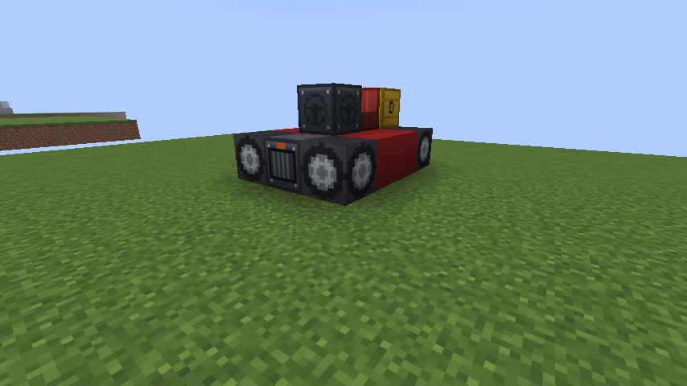
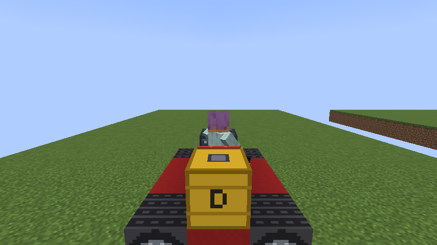

# 자동차 가이드 (Modernization World 1.0.0)

블록을 쌓아 차체를 만들고, 운전대로 조립해서 디젤로 달리는 자동차입니다. 엘리베이터·배·비행선과 같은 "움직이는 구조물"이라서, 모양은 마음대로 지을 수 있지만 **필수 부품이 모두 있어야** 조립됩니다.



## 필수 부품

| 블록 | ID | 필요한 수 | 하는 일 |
|---|---|---|---|
| 운전대 | `steering_wheel` | 1 (핵심 블록) | 우클릭하면 붙어 있는 블록을 모두 자동차로 조립합니다. 놓을 때 바라본 방향(윗면 화살표)이 자동차의 앞입니다 |
| 자동차 좌석 | `car_seat` | 1개 이상 | 운전자가 앉는 자리입니다. 등받이가 뒤로 가게 놓으세요 |
| 바퀴 | `car_wheel` | **맨 아래층에** 4개 이상 | 다른 층에 있는 바퀴는 세지 않습니다 |
| 디젤 엔진 | `car_engine` | 1개 이상 | |
| 연료통 | `fuel_tank` | 1개 이상 | 디젤 16개까지 들어갑니다. 디젤 1개로 2분(2400틱)을 달립니다 |

하나라도 모자라면 조립되지 않고 "자동차 부품이 모자랍니다: 바퀴 1개 더(맨 아래층), 디젤 엔진"처럼 무엇이 없는지 알려 줍니다. 이때 블록은 그대로 남습니다.

## 만들기

위의 사진과 같은 3×4 차입니다. 남쪽(앞)으로 달립니다.

```text
아래층(바퀴층)          위층
 바퀴  철  바퀴          .   연료통  .
  철   철   철           .    좌석   .
  철   철   철           .   운전대  .
 바퀴 엔진 바퀴          .     .     .
            ↓ 앞
```

1. 바퀴 4개를 맨 아래층 네 귀퉁이에 놓고 사이를 아무 블록으로 채웁니다. 엔진은 아래층에 넣어도 됩니다.
2. 위층에 좌석, 운전대, 연료통을 놓습니다. 운전대는 **앞을 보고 서서** 놓습니다.
3. 디젤을 들고 연료통을 우클릭해 채웁니다. 조립한 뒤 자동차를 디젤로 우클릭해도 됩니다.
4. 운전대를 우클릭하면 조립됩니다.

## 운전

- 운전대(자동차)를 우클릭해 좌석에 앉습니다.
- **W** 가속, **S** 브레이크·후진, **A/D** 방향. 방향은 굴러가는 동안에만 바뀌고, 후진할 때는 반대로 돕니다.
- 최고 속도는 약 43km/h(초당 12칸)입니다. 운전하는 동안 화면에 남은 디젤과 속도가 나옵니다.
- **한 칸 높이 턱은 넘어갑니다.** 두 칸 이상은 막힙니다.
- 받쳐 주는 것이 없으면 떨어지고, 땅에 닿으면 칸에 맞춰 섭니다.
- 바퀴가 땅에 닿아 있어야 가속합니다. 공중에서는 가속하지 않습니다.
- 연료가 떨어지면 서서히 멈춥니다. 서 있을 때는 연료를 쓰지 않습니다.
- 멈춘 뒤 운전대를 Shift+우클릭하면 다시 블록으로 돌아옵니다. 연료통에 남은 디젤도 그대로 남습니다.



## 디젤 구하기

디젤은 Analog ALU 쪽 석유에서 나옵니다. 석유 양동이를 석유 처리기에 넣고 아래를 가열하면 석유 1단위마다 디젤 1개가 나옵니다. 자세한 것은 [README.TXT](../../README.TXT) 7장을 보세요.

## 제작법

| 결과 | 배치 | 재료 |
|---|---|---|
| 운전대 | `가철가` / `철레철` / `가철가` | 가죽 4, 철 주괴 4, 레드스톤 |
| 바퀴 4개 | `양양양` / `양철양` / `양양양` | 검은 양털 8, 철 주괴 |
| 자동차 좌석 | `가  ` / `가가가` / `철 철` | 가죽 4, 철 주괴 2 |
| 디젤 엔진 | `철피철` / `피화피` / `철철철` | 철 주괴 5, 피스톤 3, 화로 |
| 연료통 | `철철철` / `철양철` / `철철철` | 철 주괴 8, 양동이 |

가 = 가죽, 철 = 철 주괴, 레 = 레드스톤, 양 = 검은 양털(연료통에서는 양동이), 피 = 피스톤, 화 = 화로

## 알아둘 점

- 자동차는 항로 표지로 자동 운항하지 않습니다. 직접 운전하세요.
- 다른 움직이는 구조물처럼, 움직이는 동안 차 위의 화로·기계·레드스톤은 작동하지 않습니다.
- 좌석이 여러 개여도 운전자는 첫 번째 좌석에 앉습니다. 다른 사람은 차 위에 서서 함께 갈 수 있습니다.
