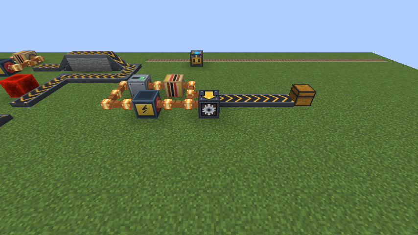
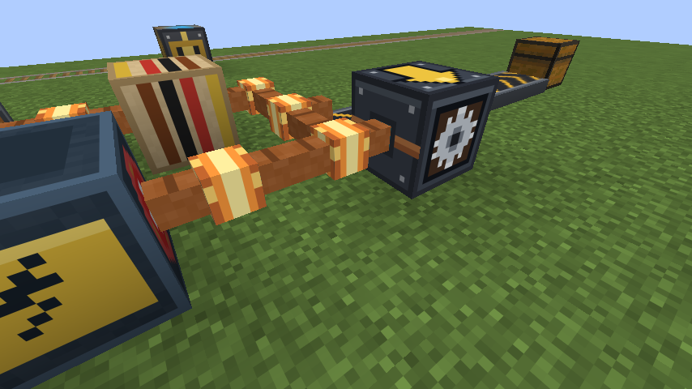
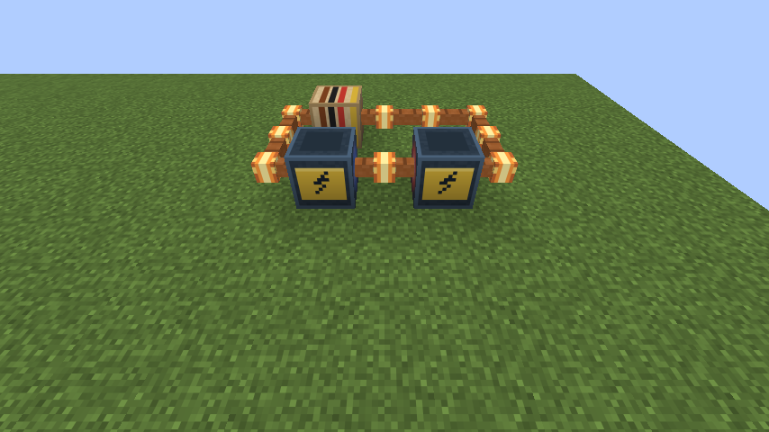
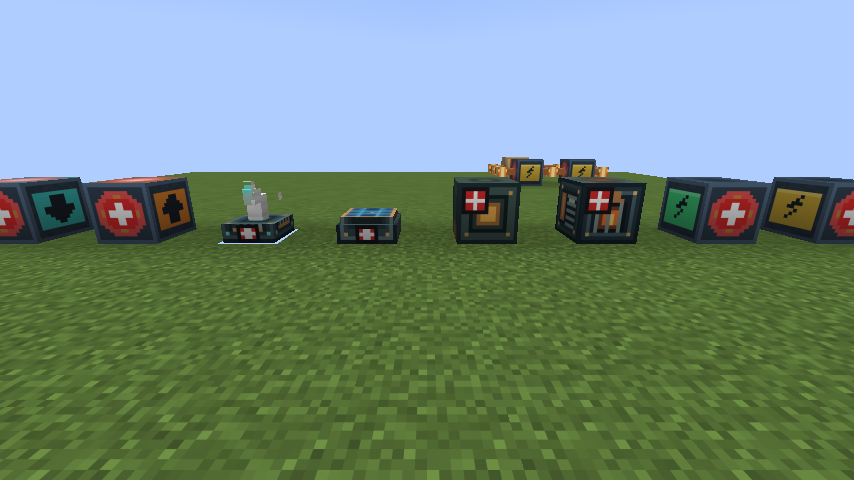
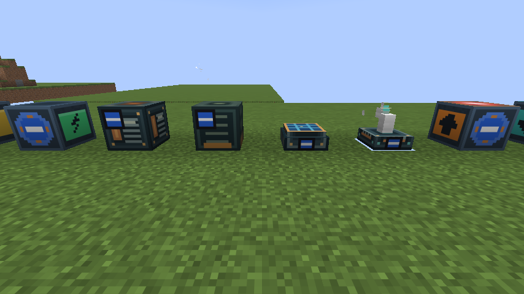

# 전기 가이드 (1.12.1)

Analog ALU 0.1.5의 전기 회로로 이 모드의 블록을 움직입니다. 레드스톤 대신 전기를 씁니다.

## 언제 전기로 작동하나요

설정이 따로 없고, 설치한 ALU 버전으로 정해집니다.

| 설치한 ALU | 작동 방식 |
|---|---|
| 0.1.5 이상 (`copper_cable`이 있는 버전) | 전기 |
| 0.1.3 이하, 또는 ALU 없음 | 지금까지처럼 레드스톤 |

## 기본 회로

ALU 회로는 **고리로 닫혀 있어야** 전기가 흐릅니다. 전원, 부하(`resistor_load`), 구리 케이블(`copper_cable`)로 고리를 만드세요. 전원과 부하, 스위치는 화살표 방향과 그 반대쪽 두 면으로 연결됩니다.

```text
 [케이블]-[스위치]-[케이블]-[부하]-[케이블]
 [케이블]                         [케이블] ← 여기에 닿은 블록이 작동
 [케이블]-[케이블]-[배터리]-[케이블]-[케이블]
```

- 작동시킬 블록은 **+ 쪽 케이블**에 닿게 놓습니다. 위 그림에서는 오른쪽 세로줄입니다. 부하를 지난 뒤의 케이블은 전압이 0이라서 아무것도 움직이지 못합니다.
- 케이블은 어느 면으로든 닿으면 됩니다. 닿으면 케이블이 그 블록 쪽으로 팔을 뻗어 연결된 모습이 보이고, ALU 0.2.0 이상에서는 전기가 흐르면 그 팔도 빛납니다. 팔이 없으면 그 블록은 케이블에서 전기를 받지 않는 블록입니다.
- 부하 없이 +와 −를 바로 이으면 합선되어 케이블이 망가질 수 있습니다.
- 한 회로에 전원을 여러 개 이을 수 있습니다(Modernization World 1.0.0부터). 아래 "전원 여러 개 잇기"를 보세요.
- 최신 ALU는 케이블을 조준하면 전압과 전류를 보여 줍니다.





## 전원 여러 개 잇기 (1.0.0)

건전지, 발전기, 승압기·변압기 출력을 한 회로에 여러 개 이을 수 있습니다. 회로 전체를 한 번에 계산하므로 실제 전기처럼 동작합니다.

**직렬: 전압이 더해집니다.** 한 전원의 + 쪽 케이블을 다음 전원의 − 쪽에 잇습니다. 9V 건전지 둘이면 18V입니다.

```text
 [케이블]-[건전지→]-[케이블]-[건전지→]-[케이블]     → 쪽이 +
     │                                    │
 [케이블]-[케이블]-[케이블]-[부하]-[케이블]
```



**병렬: 전류를 나눠 냅니다.** 두 전원의 + 쪽을 같은 케이블 줄에, − 쪽을 다른 케이블 줄에 잇습니다. 전압은 하나일 때와 같고, 전원마다 절반씩 내므로 건전지가 두 배 오래 갑니다. 병렬은 **같은 전압끼리** 잇는 것이 좋습니다. 전압이 다르면 높은 쪽에서 낮은 쪽으로 전류가 거꾸로 흘러 낭비됩니다(거꾸로 받는 쪽은 닳지 않습니다).

- 쓸 수 없는 전원(다 쓴 건전지, 연료 없는 발전기, 바람·햇빛 없는 발전기)은 회로에서 빠집니다. 직렬 중간의 건전지가 다 되면 그 줄은 끊깁니다.
- 고리가 닫히지 않아 전류가 흐르지 않으면, 지금처럼 회로 전체에 전기가 없습니다.
- 충전식 건전지는 다른 전원이 있으면 충전되고, 다른 전원이 없을 때만 전원이 됩니다.
- 케이블 전압은 회로에서 가장 낮은 곳(맨 끝 − 단자)을 0V로 잽니다.

## + 와 − 표시 (1.0.0)

모든 전원은 바라보는 면(설치할 때 플레이어를 향한 면)이 **+**, 그 반대면이 **−**입니다. 이제 이 두 면에 크게 표시됩니다.

- 건전지, 충전식 건전지, 승압기·변압기: 빨간 원에 흰 **+**, 파란 원에 흰 **−**.
- 석탄·디젤 발전기: 앞면 왼쪽 위에 빨간 **+** 표지, 뒷면에 파란 **−** 표지.
- 태양광·풍력 발전기: 아래 받침의 앞뒤에 작은 **+**, **−** 표지.
- 승압기·변압기는 앞(+)과 뒤(−)가 입력, 위(+)와 아래(−)가 출력입니다.





## 자동화 기계는 220V 200Ω (1.0.0)

벌목기를 뺀 자동화 기계 5종(자동 식재기, 성장 촉진기, 작물 수확기, 채굴 드릴, 아이템 수거기)은 이제 **220V에서 200Ω**인 부하입니다. 기계 한 대가 220V에서 1.1A, 242W를 씁니다.

- 기계는 **공장 제어기를 통해서만** 전기를 받습니다. 제어기가 연결된 기계 전체를 대표하는 부하가 되어, 기계 n대면 200/n Ω입니다(병렬). 제어기 없이 케이블에 바로 붙인 기계는 움직이지 않습니다.
- 제어기는 서로 마주 보는 두 면에 케이블을 잇습니다. 위·아래, 동·서, 남·북 순서로 처음 양쪽 다 케이블이 닿은 쌍을 씁니다.
- 기계 속도는 제어기에 걸린 전압으로 정해집니다. 220V면 최고 속도(세기 15), 그보다 낮으면 비례해서 느려집니다(110V면 세기 8).
- 제어기를 Shift+우클릭하면 지금 걸린 전압, 전류, 전력, 연결된 기계 수를 보여 줍니다.
- 220V는 승압기로 만듭니다. 승압기를 우클릭하면 나오는 화면에 **220**을 입력하세요.
- **220V 쪽 + 선은 PVC 피복 전선(600V까지 안전)으로 까세요.** 맨 구리 전선은 전기가 흐를 때 만지면 감전되고, 220V에 기계 한 대면 0.5초마다 피해 약 12입니다. 피복 전선도 이 모드의 블록에 똑같이 전기를 줍니다.
- **벌목기**는 예전처럼 전기가 닿으면 움직이고, 회로의 부하가 되지 않습니다. 제어기에 연결되면 다른 기계와 같은 속도로 돕니다.
- 기계가 늘어날수록 제어기 저항이 낮아져 더 많은 전류를 씁니다. 전원이 약하면 전압이 떨어져 공장 전체가 느려집니다.

```text
 [케이블]-[승압기 220V]-[케이블]        승압기 위(+)·아래(−)가 출력
               │
     위 케이블 ─ [공장 제어기] ─ 아래 케이블
                 [기계][기계][기계]      ← 제어기에 맞닿아 이어진 기계
```

## 전기로 작동하는 블록

| 블록 | 동작 |
|---|---|
| 동력 선로 | 전기가 닿으면 전압에 맞는 속도로 순항시키고, 끊기면 카트를 세워 둡니다 |
| 모터 I~IV | 전기가 닿으면 카트를 가속합니다 |
| 자동화 기계 | 공장 제어기를 거쳐 전기를 받습니다(위 220V 200Ω). 벌목기만 케이블에 바로 붙여도 작동합니다 |
| 공장 제어기 | 연결된 기계 수만큼의 부하(200/n Ω)로 회로에 들어가고, 걸린 전압으로 기계 속도를 정합니다. "가동" 모드도 전기가 있어야 합니다 |
| 컨베이어 | 한 줄 어디든 한 칸만 전기가 닿으면 줄 전체가 돕니다. 전기가 끊기면 멈춥니다 |
| 이동수단 제어기, 신호 중계기 | 전기를 받아 화살표 쪽으로 넘겨 줍니다 |
| 아날로그 축전기 | 케이블에서 충전됩니다 |

레버, 횃불, 레드스톤 가루, 레드스톤 블록 같은 일반 레드스톤은 이 블록들에 아무 효과가 없습니다. 스위치로 회로를 끊는 것이 레드스톤으로 끄던 것을 대신합니다.

## 전압과 세기

12V가 세기 15입니다. 세기는 지금까지의 신호 세기와 같은 뜻입니다.

| 전압 | 세기 | 동력 선로 속도 |
|---|---|---|
| 약 8.8V (9V 배터리 + 부하) | 11 | 약 17 m/s |
| 12V | 15 | 21 m/s |

## 레드스톤 신호로 남는 것

동력이 아니라 제어를 맡는 블록은 그대로입니다.

- **정거장**: 탑승 신호와 자동 출발 입력. 정거장의 탑승 신호는 동력 선로를 그대로 풀어 줍니다.
- **ALU 전차 제어기, ALU 논리 회로, 구리 전선(`copper_wire`)**
- **강화 화로의 일시 정지, 엘리베이터 호출 버튼, 항로 표지**

## 알아둘 점

- **공장 제어기만 스스로 전기를 씁니다.** 기계 수에 맞춰 부하가 되므로 기계가 많을수록 전원이 빨리 닳습니다. 다른 블록(동력 선로, 모터, 컨베이어, 벌목기)은 전압만 읽고 전기를 따로 쓰지 않으므로, 회로의 부하가 소비 전력을 정합니다.
- 전압 변화는 약 1~2초 뒤에 반영됩니다.
- 케이블의 팔은 보이는 모양일 뿐이라 회로 계산은 바뀌지 않습니다. 케이블을 우클릭해 연결을 잠가도 닿아 있는 이 모드 블록에는 계속 전기가 가므로, 팔도 그대로 남습니다.
- 1.12.0 이전에 깔아 둔 케이블은 옆 블록이 바뀔 때 팔이 생깁니다. 바로 보고 싶으면 케이블을 한 번 다시 놓으세요.
- 컨베이어 한 줄은 256칸까지 전기가 전달됩니다.
