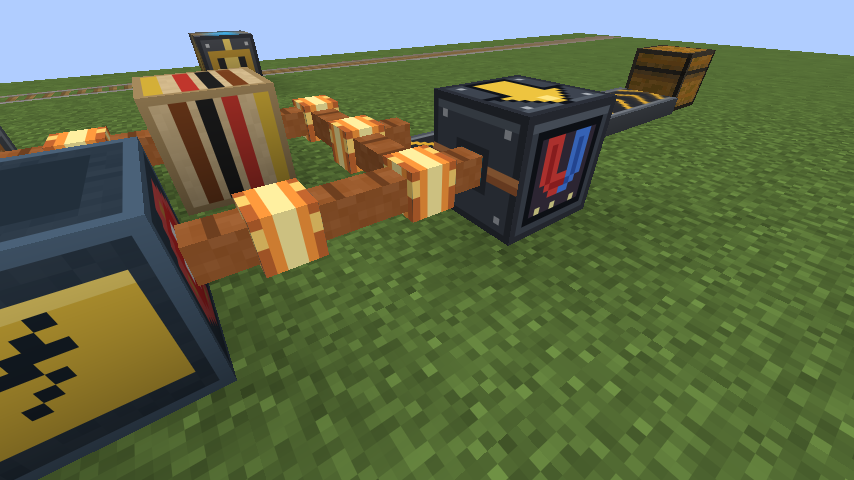

# 1.12.1 변경 사항

## 전기 연결이 보이게

Analog ALU 0.1.5 이상의 구리 케이블(`copper_cable`)이 이 모드의 전기 블록에 닿으면, 케이블이 그 블록 쪽으로 팔을 뻗습니다. ALU 0.2.0 이상에서는 전기가 흐르면 팔도 빛나므로, 어느 블록이 전기를 받고 있는지 바로 보입니다.

팔이 생기는 블록:

- 동력 선로, 모터 I~IV
- 컨베이어
- 공장 제어기, 자동화 기계 6종 (벌목기, 자동 식재기, 성장 촉진기, 작물 수확기, 채석 드릴, 아이템 수거기)
- 이동수단 제어기, 신호 중계기, 아날로그 축전기

정거장, 강화 화로, 엘리베이터 호출 버튼, 항로 표지, ALU 전차 제어기는 레드스톤 신호로 작동하므로 팔이 생기지 않습니다.

## 알아둘 점

- 팔은 보이는 모양과 선택 영역만 바꿉니다. 회로 계산과 전기가 가는 곳은 그대로입니다.
- 잠근 케이블도 이 모드 블록 쪽으로는 팔이 생깁니다. 잠금과 상관없이 전기가 가기 때문입니다.
- 1.12.0 이전에 깔아 둔 케이블은 옆 블록이 바뀌면 팔이 생깁니다. 바로 보려면 케이블을 다시 놓으세요.
- ALU가 없거나 0.1.3 이하면 케이블이 없으므로 달라지는 것이 없습니다.

팔이 생기는 블록 목록은 블록 태그 `redstone_transportation:connects_to_cable`로 정합니다. 데이터팩으로 다른 블록을 추가할 수 있습니다.

## 검증

- 서버 게임 테스트 154개가 ALU 없음, 0.1.3, 0.1.5, 0.2.0, 0.2.1에서 모두 통과했습니다. 새 테스트 두 개는 아래를 확인합니다.
  - 케이블을 먼저 놓든 나중에 놓든 모터, 컨베이어, 공장 제어기 쪽으로 팔이 생깁니다.
  - 돌이나 레드스톤 램프 쪽으로는 팔이 생기지 않고, 모터를 치우면 그쪽 팔도 사라집니다.
  - 전기가 흐르는 케이블은 기계 쪽 팔을 뻗은 채로 빛납니다(0.2.0 이상).
- ALU 없음과 0.1.3에서는 시작 로그에 케이블 관련 경고가 없습니다.
- 클라이언트 게임 테스트(ALU 0.2.1)에서 실제 클릭으로 스위치를 켜고 위 사진을 찍었습니다.
