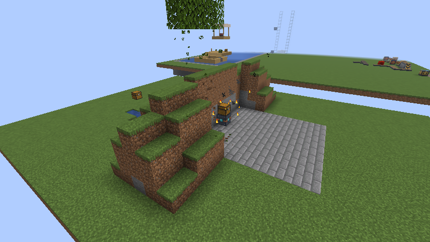
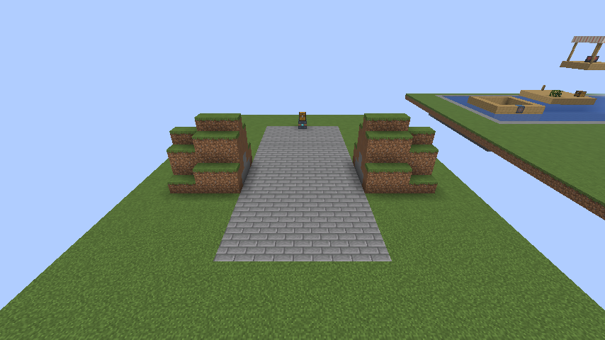
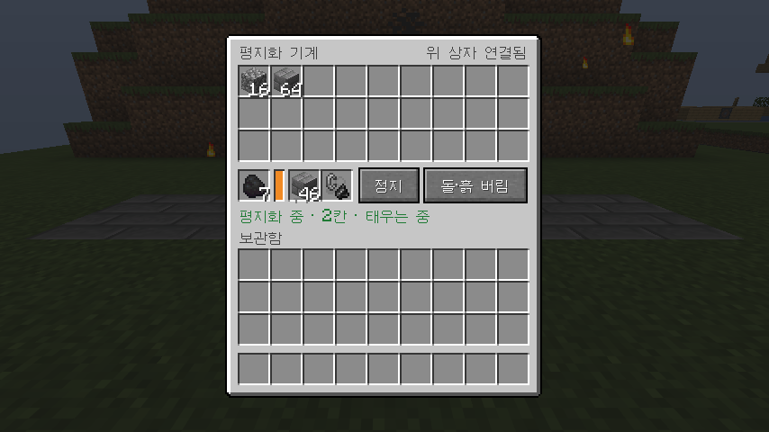

# 1.13.0 변경 사항

## 평지화 기계 (`land_leveler`)

연료로 스스로 앞으로 나아가며 땅을 평평하게 만드는 기계를 추가했습니다.





- 앞쪽 9칸 너비에서, 기계가 서 있는 높이부터 위로 32칸까지 캐냅니다.
- 바닥의 구덩이는 흙이나 돌로 메워서 지나간 길이 한 높이로 평평합니다.
- 1초에 1칸 움직이고, 석탄 하나로 80칸을 갑니다. ALU 디젤도 연료로 쓸 수 있습니다(320칸).
- 캐낸 것은 기계 안 보관함(27칸)에 들어갑니다. 기본 설정에서는 흔한 돌과 흙을 4묶음까지만 남기고 버립니다.
- 상자, 레일, 기반암, 이 모드와 ALU의 블록이 바닥에서 두 칸 안에 있으면 멈추고, 그보다 위에 있으면 그대로 두고 지나갑니다.
- 메뉴를 연 채로 따라가도 메뉴가 닫히지 않습니다.



자세한 사용법은 [`AUTOMATION_GUIDE_KO.md`](AUTOMATION_GUIDE_KO.md)의 "평지화 기계"에 있습니다.

제작법:

```text
철 삽       다이아몬드 곡괭이   철 삽
레드스톤    레드스톤 전차 모터 I  레드스톤
철 주괴     화로              철 주괴
```

발전과제 "산을 옮기는 자"(평지화 기계 만들기)가 채굴 드릴 다음에 추가됐습니다.

## 1.12.1에서 이어지는 것

- ALU 구리 케이블이 이 모드의 전기 블록 쪽으로 팔을 뻗어 연결된 모습이 보입니다. 평지화 기계는 연료로 움직이므로 케이블이 연결되지 않습니다.

## 검증

- 서버 게임 테스트 161개가 ALU 없음, 0.1.3, 0.1.5, 0.2.1에서 모두 통과했습니다. 평지화 기계 테스트 7개는 아래를 확인합니다.
  - 언덕과 나무를 자기 높이까지 깎고, 바닥 구덩이를 메우고, 상자 앞에서 멈춥니다. 들고 있던 다이아몬드와 캔 원목은 그대로 보관되고, 바닥에 떨어진 아이템은 없습니다.
  - 연료가 없으면 움직이지 않습니다.
  - "모두 보관"에서 보관함이 차면 멈추고, "돌·흙 버림"으로 바꾸면 다른 아이템을 잃지 않고 이어서 갑니다.
  - 메울 재료가 없으면 기다리다가, 조약돌 하나를 넣으면 다시 갑니다.
  - 기둥 위의 상자처럼 바닥에서 두 칸보다 높은 것은 남겨 두고 지나갑니다.
  - 메뉴의 가동 버튼으로 출발하고, 움직이는 동안에도 메뉴가 열려 있습니다.
  - 석탄, 숯, 석탄 블록, 용암 양동이, 원목, 판자의 연소 시간이 이 문서의 거리와 맞습니다.
- 클라이언트 게임 테스트에서 실제 우클릭으로 메뉴를 열고 버튼으로 출발시켜, 언덕을 지나 9칸 평지가 남는 것을 확인하고 위 사진을 찍었습니다.
- 배포용 jar로 띄운 실제 서버에서 ALU 없음(석탄), ALU 0.1.5(석탄), ALU 0.2.1(디젤) 모두 1초에 1칸씩 나아가며 벽을 깎고 구덩이를 메웠습니다.
