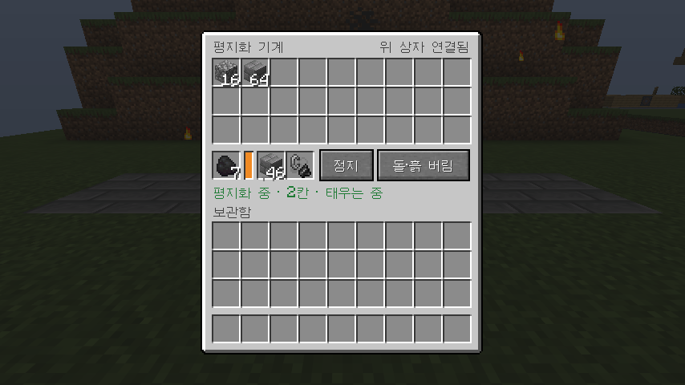
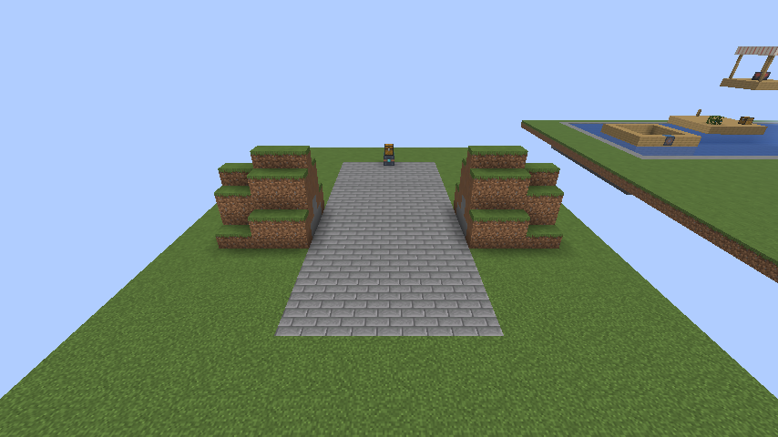

# 1.13.1 변경 사항

## 평지화 기계: 메울 블록 칸

평지화 기계 메뉴의 연료 칸 오른쪽에 **메울 블록** 칸을 추가했습니다. 여기에 넣은 블록으로 바닥 구덩이를 먼저 메웁니다.

- 꽉 찬 한 칸짜리 블록이면 무엇이든 넣을 수 있습니다. 예: 석재 벽돌, 잔디, 판자, 유리, 콘크리트.
- 반 블록·계단처럼 꽉 차지 않은 블록, 모래·자갈처럼 떨어지는 블록, 상자처럼 무언가 담는 블록은 들어가지 않습니다.
- 메우는 순서는 메울 블록 칸 → 이번에 캔 흙·돌 → 보관함의 흙·돌입니다.
- 인벤토리에서 Shift+클릭하면 블록은 메울 블록 칸으로 먼저 갑니다. 연료로도 쓰이는 블록(석탄 블록, 원목)은 연료 칸으로 갑니다.
- 빈 연료 칸과 메울 블록 칸에 마우스를 올리면 무엇을 넣는 칸인지 나옵니다.

## 흔한 돌·흙 목록 확대

"돌·흙 버림"과 자동 메우기에 쓰는 흔한 돌·흙에 돌, 심층암, 뿌리 내린 흙, 진흙, 영혼 흙, 흑암, 현무암, 매끄러운 현무암, 엔드 돌, 테라코타(16색 포함)를 더했습니다. 사막, 악지, 네더, 엔드에서도 캔 흙·돌로 구덩이를 메우고 남는 것은 버립니다.

## 호환

- 1.13.0에서 쓰던 평지화 기계는 그대로 이어서 씁니다. 보관함과 연료 칸의 아이템이 제자리에 남고, 메울 블록 칸은 비어 있습니다.

## 검증

- 서버 게임 테스트 163개가 ALU 없음, 0.1.3, 0.1.5, 0.2.1에서 모두 통과했습니다. 새 테스트 두 개는 아래를 확인합니다.
  - 메울 블록 칸의 석재 벽돌 5개로 구덩이 5개를 먼저 메우고, 여섯 번째 구덩이는 보관함의 조약돌로 메웁니다.
  - 메울 블록 칸이 석재 벽돌, 유리, 잔디, 판자는 받고 반 블록, 모래, 상자, 횃불, 다이아몬드는 받지 않습니다.
- 배포용 jar로 띄운 실제 서버에서 메울 블록 칸의 석재 벽돌 2개가 구덩이 둘을 메우고, 세 번째 구덩이는 보관함의 조약돌로 메워졌습니다.
- 클라이언트 게임 테스트에서 메울 블록 칸에 석재 벽돌을 넣고 출발시켜, 구덩이가 석재 벽돌로 메워지는 것을 사진으로 확인했습니다.
