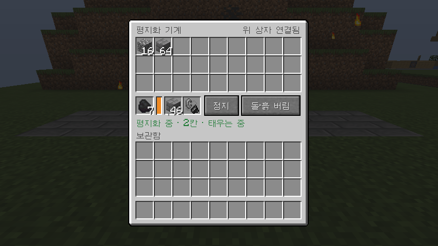
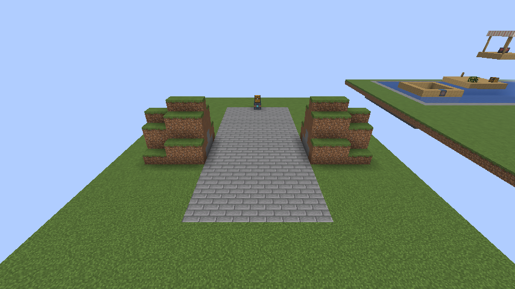

# 1.14.0 변경 사항

## 평지화 기계: 라이터

메뉴에 **라이터** 칸이 생겼습니다. 부싯돌과 부시를 넣어 두면 캔 것을 보관하지 않고 모두 태웁니다.

- 원목, 잎, 광석, 바닥에서 캔 흙·돌까지 모두 태워서 보관함이 차지 않습니다.
- 메울 블록이 없을 때는 구덩이를 메울 흙·돌 256개만 남깁니다.
- 기계 앞에 불꽃과 연기가 보이고, 메뉴에 "태우는 중"이 나옵니다.
- 부싯돌과 부시는 닳지 않습니다.

## 평지화 기계: 메울 블록으로 바닥 전체 깔기

메울 블록 칸에 블록을 넣으면 이제 구덩이뿐 아니라 **지나가는 바닥 9칸 전체**를 그 블록으로 깝니다.

- 원래 있던 바닥(잔디, 흙, 돌 등)은 캐서 보관함으로 가져옵니다. 라이터가 있으면 태웁니다.
- 메울 블록 칸이 떨어지면 **보관함에 있는 같은 블록**을 가져와 다시 채웁니다.
- 칸과 보관함에 그 블록이 하나도 없으면 "메울 블록이 떨어짐"으로 멈춥니다. 더 넣으면 이어서 깝니다.
- 칸에서 블록을 직접 꺼내면 깔기를 그만두고, 예전처럼 구덩이만 흙·돌로 메웁니다. 다 떨어져 멈췄을 때는 정지 후 다시 가동하면 깔지 않고 계속 갑니다.

1.13.1에서는 메울 블록을 구덩이에만 썼습니다. 이제 메울 블록 칸에 블록이 있으면 바닥 전체를 바꾸니, 구덩이만 메우고 싶으면 칸을 비워 두세요.

## 호환

- 예전 버전의 평지화 기계도 이어서 씁니다. 보관함, 연료 칸, 메울 블록 칸의 아이템이 제자리에 남고 라이터 칸은 비어 있습니다.

## 검증

- 서버 게임 테스트 168개가 ALU 없음, 0.1.3, 0.1.5, 0.2.1에서 모두 통과했습니다. 새 테스트 여섯 개는 아래를 확인합니다.
  - 메울 블록 칸의 석재 벽돌로 구덩이와 돌 바닥을 모두 깔고, 캔 돌 바닥 25칸이 조약돌 25개로 보관됩니다.
  - 칸의 벽돌 5개가 떨어지면 보관함의 벽돌 20개를 칸으로 옮겨 계속 깝니다.
  - 벽돌이 다 떨어지면 "메울 블록이 떨어짐"으로 멈추고, 정지 후 다시 가동하면 깔지 않고 갑니다.
  - 칸에서 벽돌을 꺼내면 보관함에 벽돌이 있어도 깔지 않습니다.
  - 라이터가 있으면 원목과 철 원석이 남지 않고, 구덩이를 메울 흙·돌만 남으며, 라이터는 닳지 않습니다.
  - 라이터 칸에는 부싯돌과 부시만 들어갑니다.
- 배포용 jar로 띄운 실제 서버에서 메울 블록 칸 10개 + 보관함 20개의 석재 벽돌로 바닥 27칸을 깔아 칸에 3개가 남았고, 보관함은 비었으며(다시 채움과 태우기), 원목이 사라지고 라이터는 그대로였습니다.
- 클라이언트 게임 테스트에서 메울 블록 칸에 석재 벽돌, 라이터 칸에 부싯돌과 부시를 넣고 출발시켜, 석재 벽돌 길이 깔리고 불꽃이 보이는 것을 사진으로 확인했습니다.
