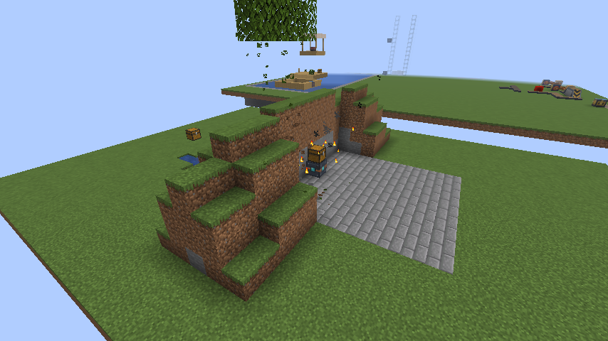
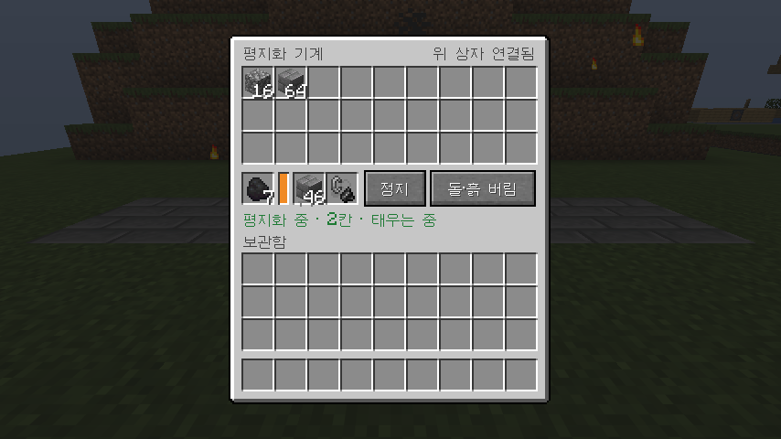

# 1.15.0 변경 사항

## 평지화 기계: 위에 올린 상자가 따라감

평지화 기계 **바로 위**에 상자를 올려 두면 기계와 함께 움직입니다.

- 상자 안의 아이템과 이름이 그대로 따라옵니다.
- 기계 보관함(27칸)이 차면 캔 것을 위 상자에 넣습니다.
- 메울 블록 칸이 비면 기계 보관함, 그다음 위 상자에서 같은 블록을 꺼내 채웁니다.
- 상자, 덫 상자, 구리 상자, 통, 셜커 상자를 쓸 수 있습니다.
- 메뉴 오른쪽 위에 "위 상자 연결됨"이 나옵니다.

## 연료 다시 채우기

연료 칸이 비면 방금까지 쓰던 것과 **같은 연료**를 기계 보관함, 그다음 위 상자에서 꺼내 채웁니다. 다른 연료(캔 원목, 막대기 등)는 쓰지 않습니다.

## 검증

- 서버 게임 테스트 172개가 ALU 없음, 0.1.3, 0.1.5, 0.2.1에서 모두 통과했습니다. 새 테스트 네 개는 아래를 확인합니다.
  - 위 상자가 다이아몬드 5개를 담은 채 따라오고, 원래 자리는 비며, 떨어진 아이템이 없습니다.
  - 기계 보관함이 판자로 꽉 차 있어도 캔 조약돌 9개가 위 상자로 들어가고 멈추지 않습니다.
  - 연료 칸의 막대기 1개, 보관함의 막대기 1개, 위 상자의 막대기 1개를 차례로 다 쓰며 12칸을 갑니다.
  - 메울 블록 칸의 벽돌 9개를 다 쓰면 위 상자의 벽돌 18개로 채워 바닥 27칸을 깝니다.
- 배포용 jar로 띄운 실제 서버에서 "Cargo"라는 이름의 상자(벽돌 18개, 다이아몬드 10개)를 올리고 출발시켰습니다. 상자가 이름과 다이아몬드를 가진 채 3칸 따라왔고, 원래 자리는 비었으며, 벽돌 18개는 바닥을 까는 데 다 쓰였습니다.
- 클라이언트 게임 테스트에서 상자를 올리고 출발시켜, 상자가 끝까지 따라오는 것과 메뉴의 "위 상자 연결됨"을 사진으로 확인했습니다.
